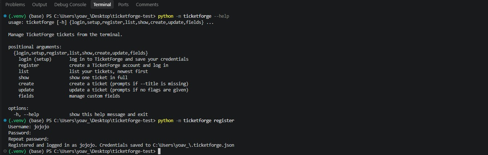
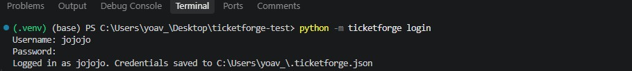
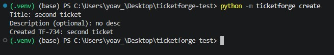
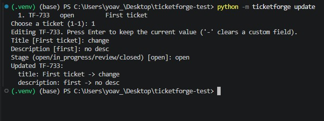
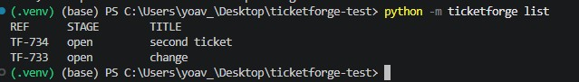
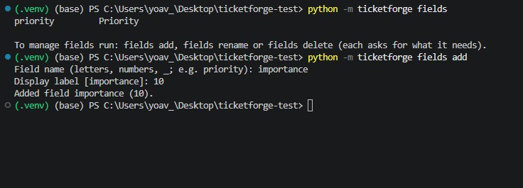

# TicketForge CLI

A command line tool for managing [TicketForge](https://integrations-assignment-ticketforge.vercel.app) tickets from the terminal: set up a connection, then list, show, create and update tickets and manage custom fields.

TicketForge has no public API docs, so the API was reverse-engineered from the web app (see [How the API was discovered](#how-the-api-was-discovered)).

## Installation

Requires Python 3.10+ (developed on 3.12).

```bash
git clone https://github.com/yoavkos/blinkops.git
cd blinkops
python -m venv .venv
.venv\Scripts\activate          # Windows
source .venv/bin/activate       # macOS / Linux
pip install -r requirements.txt
```

## Setup

Log in with an existing TicketForge account (`setup` also works as an alias):

```bash
python -m ticketforge login
```

```
Username: yoav_test
Password:
Logged in as yoav_test. Credentials saved to ~/.ticketforge.json
```

Or create a new account from the terminal, which also logs you in:

```bash
python -m ticketforge register
```

```
Username: new_user
Password:
Repeat password:
Registered and logged in as new_user. Credentials saved to ~/.ticketforge.json
```

The credentials are checked against the API before they are saved. The server's rules apply to registration: a username of 3+ characters that isn't taken, and a password of 6+ characters. Instead of the file you can use environment variables, which take precedence:

```bash
export TICKETFORGE_USERNAME=yoav_test
export TICKETFORGE_PASSWORD=...
```

```powershell
$env:TICKETFORGE_USERNAME="yoav_test"
$env:TICKETFORGE_PASSWORD="..."
```

## Usage

```bash
python -m ticketforge --help
python -m ticketforge <command> --help
```

| Command | What it does |
|---|---|
| `login` (alias `setup`) | Log in and save your credentials |
| `register` | Create a TicketForge account and log in |
| `list [--all]` | List your tickets, newest first, 5 per page. Press Enter for the next page, or use `--all` |
| `show [REF]` | Show one ticket in full (description, dependencies, custom fields). Without REF it lists your tickets to pick from |
| `create [--title T] [--description D] [--depends-on REF ...] [--field NAME=VALUE ...]` | Create a ticket. Without `--title` it asks interactively, including every custom field |
| `update [REF] [--title T] [--description D] [--stage S] [--depends-on REF ...] [--field NAME=VALUE ...] [--remove-field NAME ...]` | Update a ticket (without REF you pick it from a list). Without flags it asks for each field (Enter keeps the current value, `-` clears a custom field) |
| `fields` / `fields add` / `fields rename` / `fields delete` | Manage custom field definitions, like the web app's Manage Custom Fields. Each asks for what it needs (rename and delete let you pick from a numbered list, delete asks to confirm). You can also pass them directly: `fields add priority Priority` |

Stages: `open`, `in_progress`, `review`, `closed`.

### Examples

```
$ python -m ticketforge create --title "Login page returns 500" --description "Happens after password reset" --depends-on TF-718
Created TF-725: Login page returns 500

$ python -m ticketforge list
REF      STAGE        TITLE
TF-726   open         Write README
TF-725   open         Login page returns 500
TF-723   review       Six ticket
TF-722   open         Fifth ticket
TF-721   review       Fourth ticket
-- Press Enter for more, or q to quit:

$ python -m ticketforge update TF-725 --stage in_progress
Updated TF-725:
  stage: open -> in_progress

$ python -m ticketforge update TF-725
Editing TF-725. Press Enter to keep the current value.
Title [Login page returns 500]:
Description [Happens after password reset]: Root cause found
Stage (open/in_progress/review/closed) [in_progress]: review
Updated TF-725:
  description: Happens after password reset -> Root cause found
  stage: in_progress -> review

$ python -m ticketforge show TF-725
TF-725  Login page returns 500
  Stage:       review
  Description: Root cause found
  Depends on:  TF-718
  Created:     2026-11-03T15:19:53.097Z
  Updated:     2026-11-03T15:21:34.598Z

$ python -m ticketforge show TF-99999
Error: workitem TF-99999 does not exist
```

### Evidence that it runs

- [docs/demo.txt](docs/demo.txt): a full recorded session against the live API, including error cases.
- Screenshots from a fresh clone, installed by following this README:













## How the API was discovered

I used the web app with the browser DevTools Network tab open (Fetch/XHR, "Keep log"): registered, logged in, created and updated tickets, added a custom field and clicked "Load More". I then repeated every request with `curl`, including failure cases (wrong password, blank title, unknown ticket, invalid stage, bad cursor, oversized page, rate limit).

Base URL: `https://integrations-assignment-ticketforge.vercel.app/api/tforge`

| Action | Request |
|---|---|
| Register | `POST /user/register` `{username, password}` |
| List my tickets | `GET /workitems/mine?limit=&cursor=` -> `{workitems, pagination: {hasMore, nextCursor}}` |
| Get a ticket | `GET /workitem/{ref}?view=deep` |
| Create | `POST /workitem/publish` `{title, description, dependsOn, customFields}` |
| Update | `PUT /workitem/{ref}` `{title, description, stage, dependsOn, customFields}` |
| Custom fields | `GET/POST /custom-fields`, `DELETE /custom-fields/{id}` |

Findings that shaped the code:

- **Auth is HTTP Basic on every request.** There is no login endpoint, and the web app just calls `GET /workitems/mine`. `login` does the same to verify the credentials.
- **`PUT` replaces the whole ticket.** Fields left out are cleared: sending only `{title, stage}` wiped the description. `update` therefore fetches the ticket and sends every field back with the changes, and a test guards this.
- **Errors have one shape:** `{"err": "...", "message": "...", "retryable": ...}`. The status code alone is not reliable: an unknown ticket returns **400** with `err: not_found`, not 404. The CLI shows the server's `message`.
- **`retryable` is not trustworthy.** A malformed JSON body returned 400 with `retryable: true`. The client retries only on 429 and 5xx.
- **Pagination is cursor-based, with at most 5 items per page.** Larger `limit` values silently fall back to 5.
- **Rate limit: 50 requests per 60 seconds.** A 429 comes with a `Retry-After` header (seconds).

## Design

```
ticketforge/
  client.py     # all HTTP: auth, timeouts, retries, error parsing, one method per endpoint
  cli.py        # argparse commands, prompts and output; never builds URLs
  config.py     # load/save credentials (~/.ticketforge.json, env vars override)
  __main__.py   # entry point for `python -m ticketforge`
tests/
  test_client.py
```

- The client never prints or prompts, and the CLI never talks HTTP. Either side can be changed or reused on its own.
- Every command works both with flags (good for scripts) and interactively (prompts for whatever is missing).
- Input is validated locally where it's cheap (empty title, stage choices). Everything else is left to the server, whose messages are clear.
- **Error handling:**
  - Every API error, network error or timeout becomes an `ApiError` and is printed as one line, never a traceback.
  - Ctrl+C exits cleanly.
  - Requests time out after 10 seconds.
- **Rate limits:**
  - On 429 the client waits for `Retry-After` and retries, up to 3 times, with a warning so the user knows why it's waiting.
  - A 5xx is retried only for non-POST requests, because retrying a create could duplicate the ticket.

## Tests

```bash
python -m pytest
```

The tests use mocked HTTP responses (`responses`), so they don't touch the real API.

Client tests cover:
- the auth header
- cursor encoding
- error parsing, including non-JSON bodies
- retry on 429 (including a decimal `Retry-After`) and giving up after the limit
- no retry for POST
- network errors
- the update sending every field

CLI tests cover:
- update with flags
- an update with no changes sends nothing
- create keeps the `--description` flag when it asks for the title
- login with a wrong password doesn't save
- register sends the account and saves the credentials
- register stops when the two passwords differ
- create sends `--field` values
- `--remove-field` clears one custom field and keeps the others
- show without a ref lists the tickets and picks one by number
- fields add asks for the name and label; fields delete from the list asks before deleting

## Assumptions and limitations

- **Credentials** are stored in plain text in `~/.ticketforge.json`, as the API needs the password on every request. Use the environment variables to avoid the file. A next step would be the OS keychain (`keyring`).
- **Dependencies:** `update --depends-on` replaces the whole list, and there is no flag to clear dependencies.
- **Custom field values** are text, as the API only offers the `text` type. A ticket's custom fields are replaced as a whole on update, so the CLI always sends the full set.
- **Times** are shown as the API returns them (UTC, ISO 8601).
- **`list --all`** on an account with more than ~250 tickets will hit the rate limit. The client handles it by waiting, so it is slower but still works.
- **Interactive update** can't clear the description or edit dependencies. Use the flags instead (e.g. `--description ""`, `--depends-on`).
- **Concurrent edits:** update reads the ticket and then sends it back whole (PUT), so a change someone else makes in between is overwritten.
- **429 on create is retried**, on the assumption that a rate-limited request was not processed.

## AI disclosure

I used an AI coding assistant (Claude, via Claude Code) during this assignment. It helped me:
- prepare beforehand: REST, auth and pagination concepts
- guide the API exploration in DevTools and with `curl`
- draft the code, tests and this README
- review the finished code with a second, independent AI agent, which found a few edge cases that I then fixed

I explored the API myself in the browser, chose the CLI style and the credential storage trade-off, and reviewed and ran every step.
